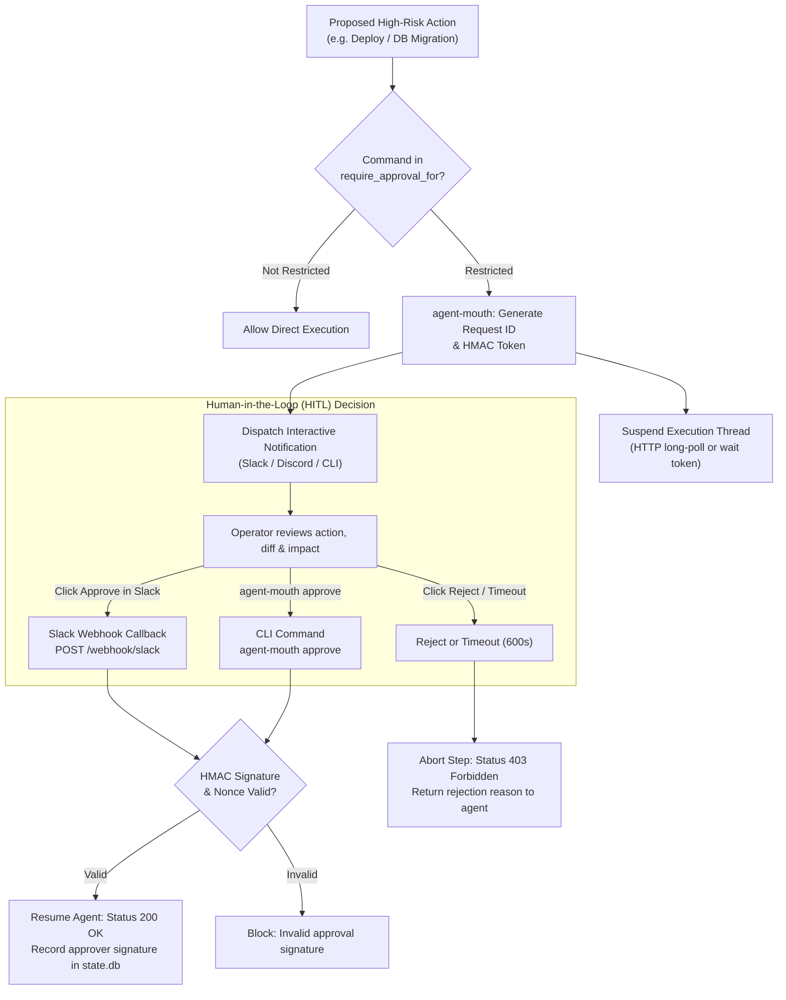

# agent-mouth — Deep Operational & Architectural Context for Agents

> **Ingress Safety Gateway, Human Approval Gates & Multi-Channel Notifications** — In-depth architectural guide, HMAC approval tokens, Slack/Discord webhook mechanics, CLI matrix, HTTP/MCP contracts, and failure recovery runbooks for `agent-mouth`.  
> **Ecosystem Version Baseline:** `v1.0.0-beta.3`  
> **Documentation Hub:** [https://autonomic-ai.dev/docs/communication](https://autonomic-ai.dev/docs/communication) · [Architecture Hub](https://autonomic-ai.dev/docs/architecture)  
> **Port:** HTTP API `:3104`  
> **Default Workspace & State:** `~/.autonomic/mouth/` · `~/.autonomic/state/mouth/`

---

## 1. Executive Summary & Biological Role

In the Autonomic 11-organ architecture, **`agent-mouth`** serves as the **Ingress & Egress Safety Gateway, Human-in-the-Loop (HITL) Gatekeeper, and Notification Dispatcher** (analogous to an API Ingress Gateway, Webhook Admission Controller, and Alertmanager).

Autonomous software agents should not perform sensitive or irreversible actions without explicit human consensus. Without a dedicated approval organ, engineering teams encounter dangerous pitfalls:
1. **Unilateral High-Risk Actions:** An agent deciding to run `git push --force`, delete a database table, rotate API credentials, or push code directly to production without operator oversight.
2. **Missing Audit Trails:** No cryptographic proof of who authorized a destructive step, when, or why.
3. **Fragmented Communication:** Alerts get lost in buried CLI terminal buffers instead of notifying the team where they actively collaborate (Slack, Discord, webhooks).

`agent-mouth` provides a secure, structured communication and approval bridge:
- **Cryptographic Approval Gates:** Blocks execution on high-risk operations, issuing HMAC-signed approval requests that require human authorization.
- **Interactive Multi-Channel Notifications:** Posts rich notification cards with diff summaries and interactive buttons to Slack, Discord, or the CLI.
- **Action Summarization:** Compresses proposed actions into concise executive briefs, ensuring human reviewers can quickly understand the intent and impact.

---

## 2. Core Architecture & Approval Lifecycle



### 2.1 Cryptographic Approval Tokens & Tamper Protection
When a critical step triggers an approval requirement:
- `agent-mouth` generates a cryptographically unique `request_id`, a timestamp, and an **HMAC-SHA256 signature** computed over the action payload.
- Approval requests can only be resolved if the incoming callback supplies a valid signature matching the local secret (`~/.autonomic/mouth/secret.key`).
- **Nonce & Expiry Protection:** Requests automatically expire after a configurable deadline (`approval_timeout_secs`, default 600s) to prevent replay attacks or stale executions.

### 2.2 Slack & Discord Webhook Integration
- **Slack Interactive Cards:** Formats proposed actions with Markdown fields (Repository, Proposed Command, Estimated Blast Radius, Git Diff Stat) and attaches interactive "Approve" and "Reject" buttons.
- **Bi-directional Webhook Receiver:** Exposes an HTTP listener (`POST /webhook/slack`) that receives the interactive button payload from Slack, validates the Slack signing secret, updates the approval state, and unblocks the waiting process.

---

## 3. Complete CLI Command Reference & Flags

`agent-mouth` provides a single native binary for daemon service, notification dispatch, and manual gate resolution:

### 3.1 Daemon & Webhook Receiver
- `agent-mouth serve`: Start the HTTP REST API and webhook callback listener.
  - `--port <PORT>`: HTTP listening port (default: `3104`).
  - `--slack-webhook <URL>`: Slack Incoming Webhook URL.
  - `--approval-timeout-secs <SECS>`: Default timeout before automatically rejecting pending requests (default: `600`).

### 3.2 Notification & Request Dispatch
- `agent-mouth send`: Dispatch an informational notification to configured channels.
  - `--channel <slack|discord|cli>`: Target notification destination.
  - `--message "<TEXT>"`: Message body text.
  - `--severity <info|warning|critical>`: Visual alert severity level.
- `agent-mouth request --action "<ACTION>"`: Issue an approval request and block until resolved.
  - `--metadata "<JSON>"`: Structured metadata context (e.g. `{ "cwd": "...", "diff_stat": "..." }`).
  - `--timeout <SECS>`: Specific timeout override for this request.

### 3.3 Manual Approval & Gate Resolution
- `agent-mouth approve <REQUEST_ID>`: Manually approve a pending gate.
  - `--approver "<NAME>"`: Identity of the approving operator (default: `$USER`).
  - `--notes "<TEXT>"`: Optional review comment.
- `agent-mouth reject <REQUEST_ID>`: Manually reject a pending gate.
  - `--reason "<STRING>"`: Reason for rejection (returned to agent runtime).

### 3.4 Diagnostics & Health Audit
- `agent-mouth doctor`: Verify Slack/Discord webhook credentials, validate local HMAC signing keys, and test HTTP port availability.

---

## 4. HTTP & Model Context Protocol (MCP) Contracts

### 4.1 HTTP REST Endpoints (`:3104`)

#### `POST /approval/request`
Submit a task or command for human approval.
Request:
```json
{
  "action": "git push origin main --force",
  "requested_by": "agent-spine-worker-3",
  "metadata": {
    "repo": "autonomic-ai-dev/agent-brain",
    "diff_lines": "+12 -4"
  },
  "timeout_secs": 300
}
```
Response (`200 OK`):
```json
{
  "request_id": "appr_01J8N4KZ...",
  "status": "pending",
  "expires_at": "2026-10-17T16:15:00Z"
}
```

#### `POST /approval/resolve`
Resolve a pending approval gate.
Request:
```json
{
  "request_id": "appr_01J8N4KZ...",
  "decision": "approve",
  "approver": "alex"
}
```

#### `POST /webhook/slack`
Receives Slack interaction payloads from interactive approval buttons.

#### `GET /health`
Returns gateway status, pending approval queue depth, and channel connectivity.

---

### 4.2 MCP Tools (via `agent-body serve-mcp` or stdio)

#### `mouth_request_approval`
- **Description:** Blocks agent execution until a human operator approves the step via Slack, Discord, or CLI.
- **Parameters:**
  - `action_description` (string, required): Clear explanation of the intended action and why approval is needed.
  - `command` (string, optional): Exact shell command to be executed if approved.
  - `timeout_secs` (integer, optional, default `600`): Maximum seconds to wait.
- **Return Object:**
  - `approved`: Boolean flag (`true` if approved, `false` if rejected or timed out).
  - `approver`: Name or ID of the operator who approved.
  - `rejection_reason`: Explanation if rejected.

#### `mouth_validate_ast`
- **Description:** Pre-flights a shell command against strict AST safety heuristics to determine if an approval gate must be triggered.
- **Parameters:**
  - `command` (string, required): Shell command string.

#### `mouth_send_notification`
- **Description:** Sends an asynchronous alert message to configured team channels without blocking execution.
- **Parameters:**
  - `message` (string, required): Alert message text.
  - `channel` (string, optional, default `"slack"`): Destination channel (`"slack"`, `"discord"`, `"cli"`).

---

## 5. Troubleshooting & Recovery Runbook

### 5.1 Problem: Agent Hangs Waiting for Approval
- **Symptom:** Agent step is paused waiting for `mouth_request_approval`.
- **Resolution:**
  - Check active pending requests:
    ```bash
    curl -s http://127.0.0.1:3104/approval/pending
    ```
  - Manually approve or reject from terminal:
    ```bash
    agent-mouth approve <request_id> --approver "local-dev"
    ```

### 5.2 Problem: Slack Notifications Failing to Deliver
- **Cause:** Missing or expired Slack webhook URL.
- **Resolution:**
  - Verify webhook configuration in `~/.autonomic/config.toml`:
    ```toml
    [mouth]
    slack_webhook_url = "https://hooks.slack.com/services/..."
    ```
  - Run diagnostic probe: `agent-mouth doctor`.
